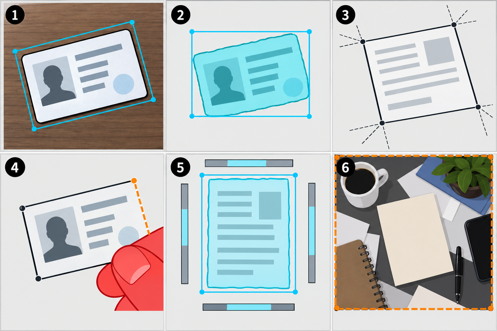

# Luồng xử lý AI Engine

Tài liệu này mô tả luồng đang chạy trong project hiện tại. Laravel gọi FastAPI tại `POST /process`; AI Engine chạy pipeline tuần tự, đọc OCR trên ảnh đã xử lý, chuẩn hóa trường dữ liệu và trả kết quả về Laravel.

## 1. Sơ đồ tổng quát

```text
Người dùng chọn ảnh trên Laravel UI
        |
        v
DocumentController lưu ảnh gốc private
        |
        v
AiImageProcessor -> POST http://127.0.0.1:8000/process
        |
        v
orientation -> document crop/perspective -> deskew
        -> deglare -> deblur -> enhance
        -> document_final.jpg
        |
        +-> PP-OCRv5 detector -> VietOCR recognition
        +-> structured extraction theo nhãn + polygon
        +-> YuNet face detection/crop
        |
        v
Laravel lưu ảnh, OCR JSON và trạng thái vào private storage/MySQL
```

Pipeline không dùng UVDoc. `orientation_corrected.jpg` chỉ là output trung gian để kiểm tra chiều; nếu model dự đoán ảnh đã đúng chiều thì file có thể giống ảnh đầu vào. Ảnh Laravel hiển thị sau cùng là `document_final.jpg`.

## 2. API FastAPI

| Endpoint | Công dụng |
| --- | --- |
| `GET /health` | Trả `status: ok` để kiểm tra server |
| `POST /process` | Pipeline đầy đủ được Laravel sử dụng |
| `POST /ocr` | OCR trực tiếp ảnh upload, không chạy tiền xử lý |
| `POST /preprocess` | Chạy cùng pipeline đầy đủ nhưng chỉ trả file JPEG cuối, không trả OCR JSON |

AI Engine nhận `.jpg`, `.jpeg`, `.png`, `.webp` với dung lượng **không vượt quá 10 MB**. Engine kiểm tra dung lượng, mở ảnh bằng Pillow để xác minh nội dung ảnh, rồi mới chạy OCR/pipeline. Chuẩn **98 KB–3 MB** và **350–4096 px** không áp lên ảnh upload; chúng được áp ở bước resize/enhance để tạo `document_final.jpg`. File upload được đặt tạm trong `ai-engine/tmp/` rồi xóa. Vì pipeline sử dụng các output chung trong `ai-engine/output/`, `asyncio.Lock` chỉ cho một lượt chạy pipeline đầy đủ (`/process` hoặc `/preprocess`) tại một thời điểm. Endpoint `/ocr` không dùng lock này; OCR trực tiếp dùng `_ocr_predict_lock` riêng trong `ocr_service.py`.

## 3. Các bước tiền xử lý

| Thứ tự | Script | Kết quả |
| --- | --- | --- |
| 1 | `test_orientation_rotate.py` | `orientation_corrected.jpg` |
| 2 | `test_document_crop.py` | `document_detection.jpg`, `document_mask.jpg`, `document_crop.jpg` |
| 3 | `test_deskew.py` | `document_deskew.jpg` |
| 4 | `test_glare.py` | `glare_mask.jpg`, `glare_detection.jpg`, `document_deglare.jpg` |
| 5 | `test_deblur.py` | `document_deblur.jpg` |
| 6 | `test_enhance.py` | `document_final.jpg` |

### 3.1 Chỉnh chiều

`PP-LCNet_x1_0_doc_ori` phân loại hướng 0/90/180/270 độ trên CPU. Bước này chỉ xoay toàn ảnh khi ảnh bị quay ngang hoặc lộn ngược; không xác định góc giấy tờ và không làm phẳng phối cảnh.

### 3.2 Xác định góc và perspective crop

**Script:** `test_document_crop.py`<br>
**Input:** `output/orientation_corrected.jpg`<br>
**Output chính:** `output/document_crop.jpg`

Ảnh được thu nhỏ sao cho cạnh dài tối đa 1200 px khi nhận diện để giảm chi phí xử lý. Sau khi tìm được góc, tọa độ được quy đổi ngược về kích thước ảnh gốc. Bốn góc luôn được chuẩn hóa theo thứ tự:

```text
P1: trên-trái     P2: trên-phải
P4: dưới-trái     P3: dưới-phải
```

#### Mô hình sử dụng

Bước xác định bốn góc không dùng YOLO, segmentation model hoặc model AI chuyên phát hiện giấy tờ. Phần lớn cơ chế là thuật toán OpenCV và luật hình học. Riêng fallback cuối về bố cục chữ mới gọi **detector** PP-OCRv5 để lấy polygon các vùng chữ; recognizer OCR không được dùng để quyết định bốn góc.

#### Cơ chế tìm bốn góc

**Nhánh chính — biên và contour:**

1. Chuyển ảnh sang grayscale, Gaussian blur, Canny (`40/120`) và morphology close kernel `7x7` để nối các cạnh giấy tờ bị đứt.
2. Lấy contour bằng `RETR_LIST`, xấp xỉ với `approxPolyDP` có epsilon bằng 2% chu vi.
3. Chỉ giữ contour lồi có đúng bốn đỉnh, sắp theo thứ tự trên-trái, trên-phải, dưới-phải, dưới-trái.
4. Chấm điểm những ứng viên còn lại, lấy ứng viên có điểm lớn nhất.

**Bộ lọc và chấm điểm ứng viên:**

| Tiêu chí | Quy tắc hiện tại | Vai trò |
| --- | --- | --- |
| Diện tích contour | Từ 8% đến 95% diện tích ảnh detect | Bỏ nhiễu nhỏ và contour gần bằng toàn khung. |
| Tỷ lệ dài/rộng | 1,35–2,20 theo `minAreaRect` | Giữ ứng viên có dáng thẻ/giấy tờ. |
| Độ lấp đầy hình chữ nhật | Tối thiểu 0,45 diện tích `minAreaRect` | Loại vùng méo, rời rạc hoặc chỉ là chi tiết bên trong. |
| Hai cạnh đối diện | Độ tương đồng của mỗi cặp tối thiểu 0,60 | Hạn chế hình thang quá méo và cạnh giả. |
| Góc | Sai số góc trung bình so với 90° không quá 35° | Kiểm tra tứ giác gần với khung giấy tờ. |
| Mép khung hình | Đỉnh trong biên 1% ảnh bị nhân điểm 0,7 | Không ưu tiên contour chạm mép ảnh. |

Điểm cuối là tích của tỷ lệ diện tích, độ chữ nhật, độ tương đồng hai cặp cạnh, độ gần với tỷ lệ tham chiếu 1,586 và điểm góc. Các ngưỡng là luật tổng quát để phân biệt giấy tờ với hình chữ nhật khác, không được gắn với một file ảnh cụ thể.

**Nhánh theo màu và ROI:**

Nếu nhánh cạnh không có tứ giác phù hợp, hệ thống tạo mask HSV cho vùng xanh/xanh xám của CCCD và thử contour tứ giác từ mask. Khi mask chỉ tạo được vùng màu thô, ROI của vùng đó được mở rộng rồi chạy lại detector cạnh bên trong ROI.

Một mask HSV riêng cho giấy tờ vàng/be như giấy phép lái xe dùng Hue 10–45, Saturation từ 10, Value từ 80 và morphology close kernel `17x17`. Mask CCCD dùng Hue 70–155, Saturation từ 10, Value từ 40; fallback của nó thử kernel close 5, 15 và 31 rồi chọn ứng viên tốt nhất. Cả hai dùng `minAreaRect`, diện tích 3–90% ảnh, tỷ lệ 1,35–2,20, độ chữ nhật tối thiểu 0,40 và loại khung vượt biên ảnh. Nhánh vàng/be không trim contour để tránh cắt nội dung sát mép; nhánh CCCD chỉ trim 4% biên khi kết quả vẫn giữ ít nhất 92% chiều rộng/cao của khung ban đầu. Nếu ứng viên CCCD thắng, crop được nới 10% vì mask màu có thể bỏ sót vùng sáng hoặc viền nhựa trong.

#### Fallback hình học

Khi contour không đủ bốn cạnh rõ ràng, các fallback chạy theo thứ tự. Hình dưới chỉ minh họa cơ chế, không phải kết quả detection của ảnh người dùng.



1. **`minAreaRect` từ cạnh ngoài hoặc mask màu.** Dùng contour ngoài cùng của Canny hoặc contour mask màu để tạo hình chữ nhật xoay. Nhánh edge chỉ nhận vùng 3–80% ảnh; vùng nhỏ chạm mép bị loại để không nhầm ảnh chân dung/khối chữ thành cả giấy tờ.
2. **Hộp bao HSV thô.** Khi một cạnh bị che hoặc mask màu không khép kín, dùng bbox của vùng HSV bao ngoài; bbox chỉ được nhận nếu tỷ lệ, diện tích và khoảng cách đến biên ảnh hợp lý.
3. **Ghép đường phối cảnh bằng Hough Lines.** Từ các cặp đường ngang/dọc nghiêng, lấy giao điểm để tạo bốn góc, kiểm tra diện tích dự đoán và mức độ các cạnh dự đoán được edge hỗ trợ.
4. **Khôi phục từ ba cạnh khi bị che.** Khi chỉ còn ba cạnh rõ, hệ thống suy ra cạnh thiếu theo các tỷ lệ giấy tờ hợp lệ rồi kiểm tra support của ba cạnh tốt nhất. Nếu cả nhánh ba cạnh và phối cảnh đều có kết quả, nhánh ba cạnh chỉ được ưu tiên khi diện tích lớn hơn ứng viên phối cảnh trên 1,35 lần.
5. **Tách giấy tờ khỏi nền đồng nhất.** Ước lượng màu nền bằng median của bốn dải biên trong LAB, lấy vùng có khoảng cách màu lớn hơn nền, morphology close rồi kiểm tra lại diện tích, tỷ lệ và độ chữ nhật.
6. **Fallback bố cục chữ.** Chỉ sau khi nhánh cạnh/màu/hình học thất bại, `detect_text_lines()` của PP-OCRv5 lấy polygon ít nhất sáu dòng chữ. `minAreaRect` bao các polygon đó phải có tỷ lệ 1,35–2,20 và chiếm 4–65% ảnh; khung chữ được nới 18% để suy ra khung giấy tờ. Detector này chỉ dùng polygon, không dùng nội dung hay dữ liệu nhận dạng OCR.
7. **Fallback toàn ảnh an toàn.** Nếu không còn ứng viên, hoặc ứng viên chỉ là một dải dọc/ngang chạm biên trong khi ảnh nguồn đã có tỷ lệ thẻ, hệ thống giữ bốn góc toàn ảnh để không crop nhầm và làm mất nội dung.

#### Từ bốn góc đến ảnh crop

Sau khi chọn khung, hệ thống dùng padding mặc định 3%; fallback OCR text-layout dùng 2%, fallback toàn khung dùng 0%, còn fallback màu CCCD hoặc nhánh phối cảnh có thể dùng 10% theo quy tắc phía trên. `cv2.getPerspectiveTransform` tạo homography và `cv2.warpPerspective` biến đổi tứ giác thành ảnh chữ nhật phẳng. Đây là bước vừa crop vừa nắn phối cảnh, kết quả là `document_crop.jpg`.

| File | Mục đích |
| --- | --- |
| `output/document_detection.jpg` | Vẽ bốn góc cuối cùng trên ảnh gốc. |
| `output/document_mask.jpg` | Mask/cạnh của nhánh được dùng khi có mask debug. |
| `output/document_crop.jpg` | Ảnh đã crop và chỉnh phối cảnh. |

### 3.3 Deskew, khử chói, khử mờ và enhance

- Deskew dùng Canny + HoughLinesP để ước lượng góc đường văn bản, sau đó xoay với canvas mở rộng.
- Khử chói tìm vùng sáng/ít bão hòa trong HSV, rồi giảm sáng kênh L của LAB.
- Khử mờ đo độ sắc nét bằng Laplacian và áp dụng unsharp mask thích ứng.
- Enhance dùng CLAHE trên kênh sáng LAB, sau đó chuẩn hóa ảnh kết quả. Ảnh rộng hơn 1600 px được thu nhỏ theo tỷ lệ; ảnh có cạnh nhỏ hơn 350 px được phóng to theo tỷ lệ nếu vẫn không vượt 4096 px, hoặc thêm viền trắng khi cần. JPEG được thử quality từ 95 đến 50; nếu còn lớn hơn 3 MB thì tiếp tục thu nhỏ theo tỷ lệ. Nếu JPEG nhỏ hơn 98 KB, engine thêm JPEG COM segment hợp lệ để đạt mức file tối thiểu mà không thay đổi điểm ảnh. Kết quả `document_final.jpg` luôn có mỗi chiều trong **350–4096 px** và dung lượng **98 KB–3 MB**.

## 4. OCR trên ảnh cuối

Pipeline luôn OCR `output/document_final.jpg`, không OCR trực tiếp ảnh gốc.

### 4.1 Detect: PP-OCRv5

`ocr_service.py` dùng `PP-OCRv5_server_det` thông qua PaddleX/ONNX Runtime CPU. Detector trả polygon bốn điểm và confidence của vùng chữ. Mỗi polygon được nới nhẹ rồi perspective warp thành dòng thẳng để recognition, giúp hạn chế mất dấu tiếng Việt.

### 4.2 Recognition: VietOCR

Recognizer cố định là `VietOCR vgg_transformer`, chạy PyTorch CPU với cấu hình tiếng Việt. Model được khởi tạo một lần và khóa khi inference.

`ocr_raw_result.json` lưu toàn bộ dòng đọc được, text, confidence recognition, `detection_confidence` và polygon. Confidence chỉ là mức tin cậy tham khảo, không phải bảo đảm dữ liệu chính xác.

## 5. Chuẩn hóa dữ liệu và khuôn mặt

`test_structured_extraction.py` gọi `build_structured_result()` trong `structured_extraction.py`; bước này dùng OCR thô + polygon, không OCR lại.

1. Chuẩn hóa Unicode NFC, khoảng trắng và tạo khóa không dấu để nhận diện nhãn tiếng Việt bị mất dấu.
2. Nhận diện loại giấy tờ dựa trên tiêu đề và tổ hợp nhãn: CCCD, giấy phép lái xe hoặc giấy đăng ký xe.
3. Ghép nhãn với giá trị cùng dòng/bên phải; địa chỉ nhiều dòng được ghép theo anchor polygon và khoảng cách thích nghi theo chiều cao dòng.
4. Chuẩn hóa bảo thủ: không đủ căn cứ thì để trống; giữ dòng không gán trường trong `unmapped_raw_lines`.
5. Nhận diện khuôn mặt bằng `cv2.FaceDetectorYN` (YuNet) trên `document_final.jpg`, thêm padding và trả ảnh crop nếu phát hiện được.

Các bộ trường cố định:

- CCCD: số, họ tên, giới tính, ngày sinh, quốc tịch, quê quán, nơi thường trú, giá trị đến.
- Giấy phép lái xe: số, họ tên, ngày sinh, quốc tịch, nơi cư trú, hạng/class, giá trị đến.
- Đăng ký xe: tên chủ xe, địa chỉ, nhãn hiệu, số loại, số máy, số khung, màu sơn, hoạt động trong phạm vi, biển số, số chỗ ngồi, giá trị đến ngày, công suất, loại xe, dung tích.

## 6. Payload trả về cho Laravel

```json
{
  "status": "completed",
  "processed_image": {"filename": "document_final.jpg", "media_type": "image/jpeg", "base64": "..."},
  "ocr": {"raw": {}, "structured": {}},
  "face_crop": {"media_type": "image/jpeg", "base64": "..."}
}
```

`face_crop` là `null` nếu không phát hiện mặt. Laravel giải mã payload, lưu ảnh vào `storage/app/private/documents/processed/` và `faces/`, lưu hai JSON vào `image_documents`, rồi hiển thị ảnh cuối, các trường chuẩn hóa và toàn bộ dòng OCR theo quyền. Hai khối JSON kỹ thuật chỉ hiển thị cho Admin.

Nếu pipeline, HTTP payload, base64 hoặc JSON lỗi, Laravel đánh dấu hồ sơ `failed` và ghi chi tiết kỹ thuật vào `storage/logs/laravel.log`; UI chỉ hiển thị thông báo lỗi tổng quát.

## 7. Chạy thủ công

```bash
cd /home/user/document-image-preprocessing-system/ai-engine
source venv/bin/activate
python pipeline.py input/cccd_1.jpg
```

Output debug dùng chung và có thể bị ghi đè ở lượt chạy sau. Lịch sử thật của từng hồ sơ nằm trong private storage và MySQL do Laravel quản lý. Khi chạy qua giao diện Laravel, không dùng `/preprocess`; ứng dụng luôn gọi `/process` để nhận cả ảnh, OCR và metadata face crop trong một response JSON.
